# SoloFileManager

### A powerful single-file PHP file manager for your server.

Manage files directly from your browser — without installing WordPress, Laravel, a database, Node.js or any other framework.

### One PHP file. No installation. No database.

Current version: **1.3.6** — see [CHANGELOG.md](CHANGELOG.md)

## Why SoloFileManager?

- 🚀 Single PHP file
- 📦 No database required
- 🔧 Works on shared hosting, VPS and XAMPP
- 📁 Upload, download, copy, move and rename files
- 🗑️ Trash and restore
- 📦 ZIP compression and extraction
- 🔐 Built-in authentication
- 🖥️ Optional terminal
- ⚡ Fast and lightweight
- 🆓 MIT License

## Screenshots

<table>
    <tr>
        <td width="100%" colspan="2">
            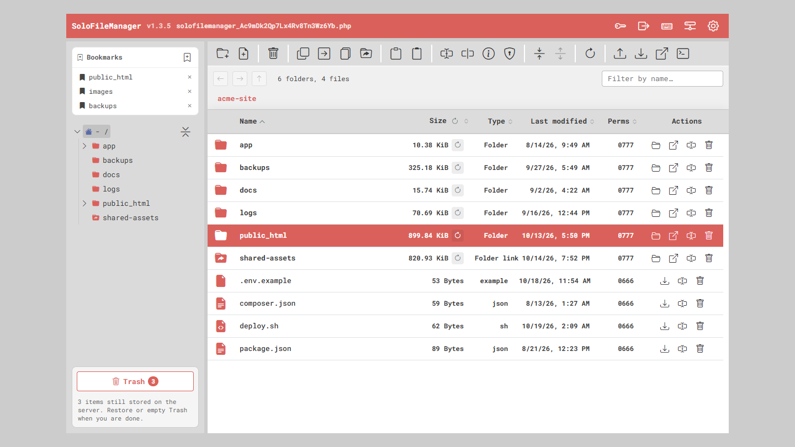
        </td>
    </tr>
    <tr>
        <td width="50%">
            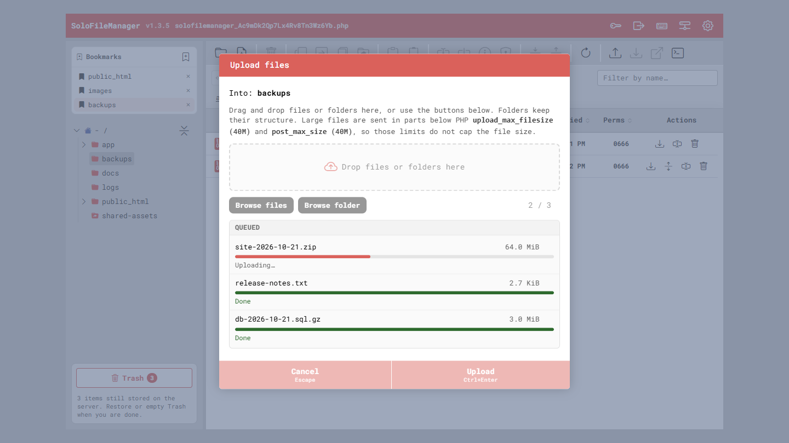
        </td>
        <td width="50%">
            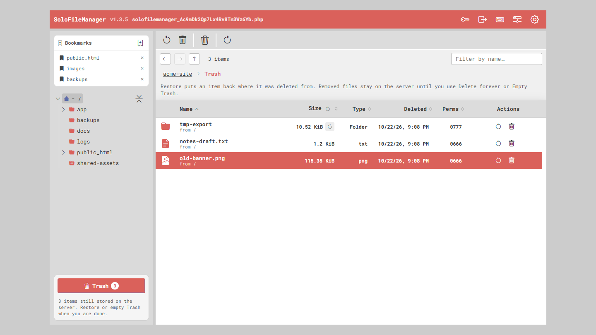
        </td>
    </tr>
    <tr>
        <td width="50%">
            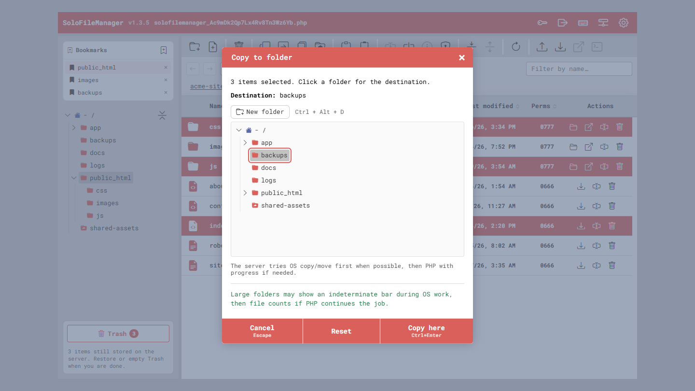
        </td>
        <td width="50%">
            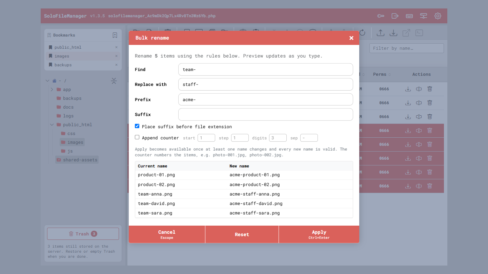
        </td>
    </tr>
    <tr>
        <td width="50%">
            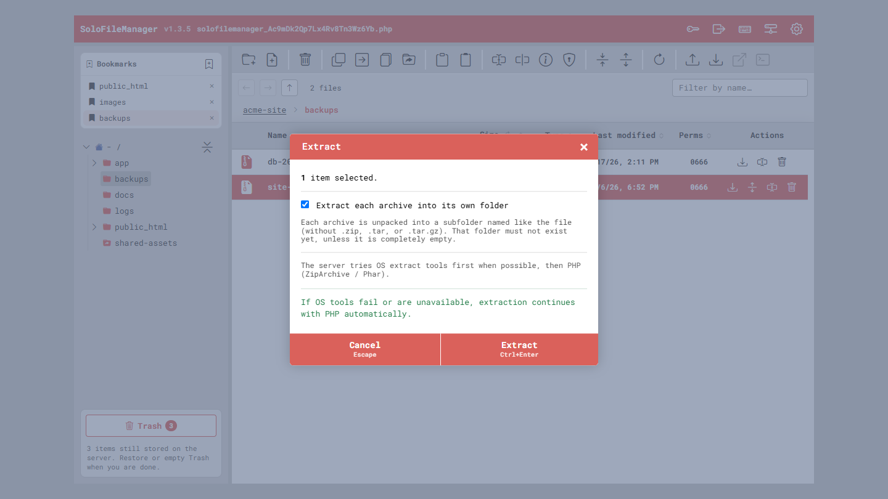
        </td>
        <td width="50%">
            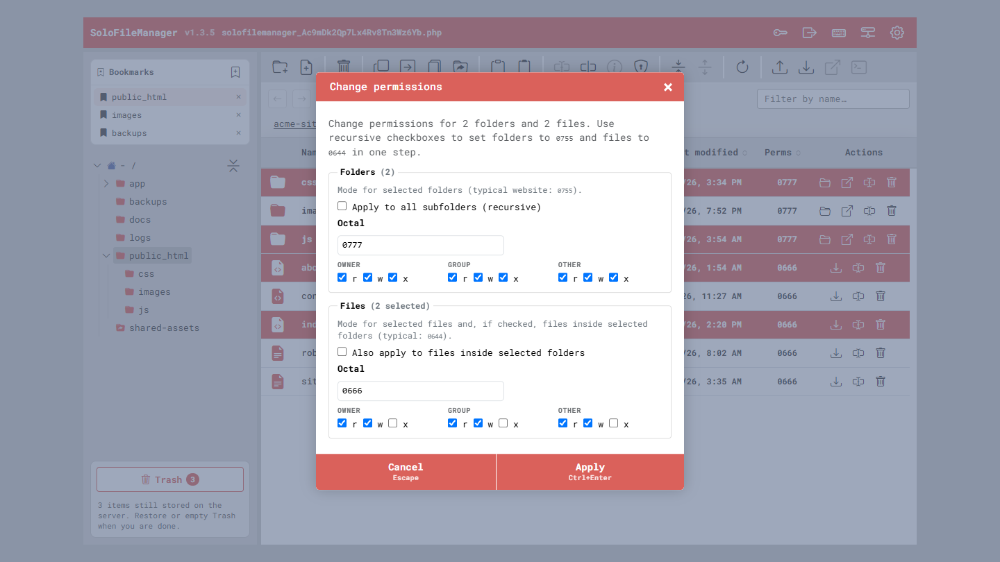
        </td>
    </tr>
    <tr>
        <td width="50%">
            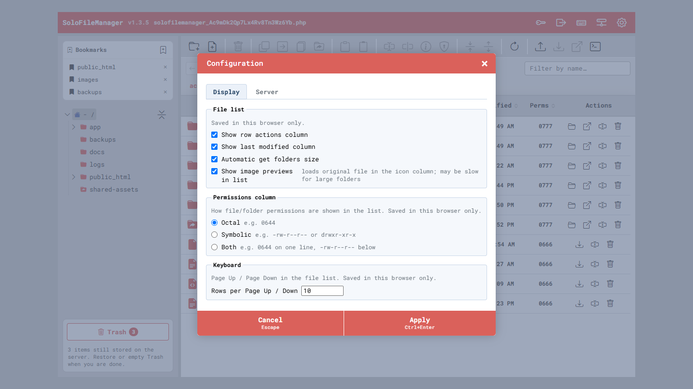
        </td>
        <td width="50%">
            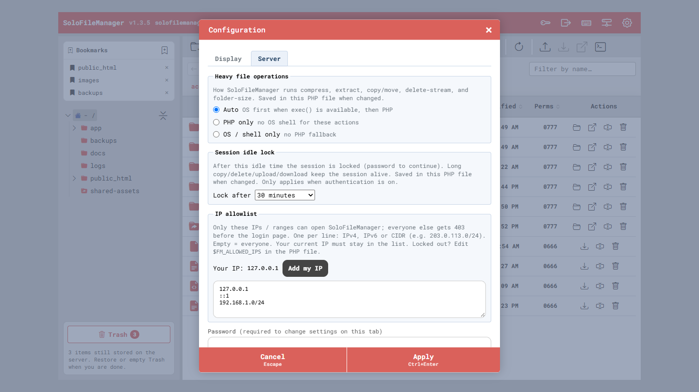
        </td>
    </tr>
    <tr>
        <td width="50%">
            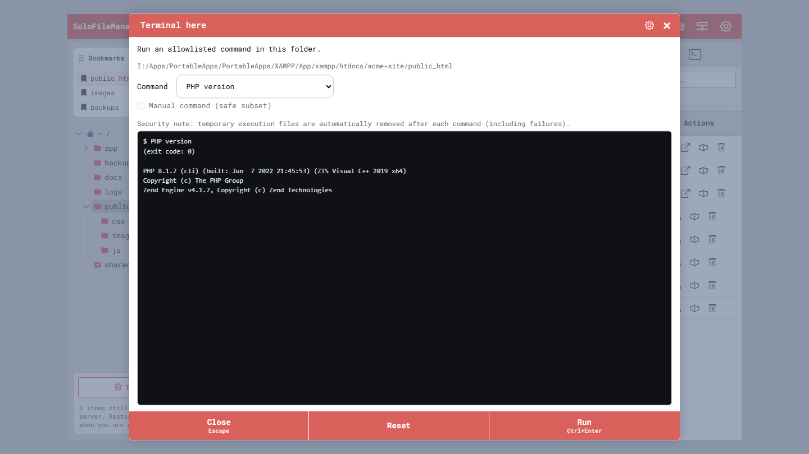
        </td>
        <td width="50%">
            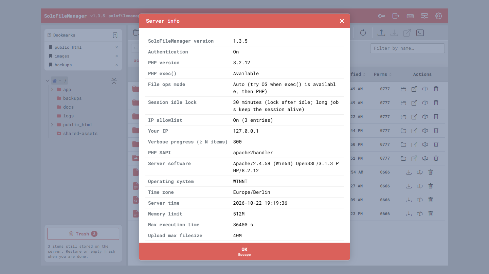
        </td>
    </tr>
    <tr>
        <td width="50%">
            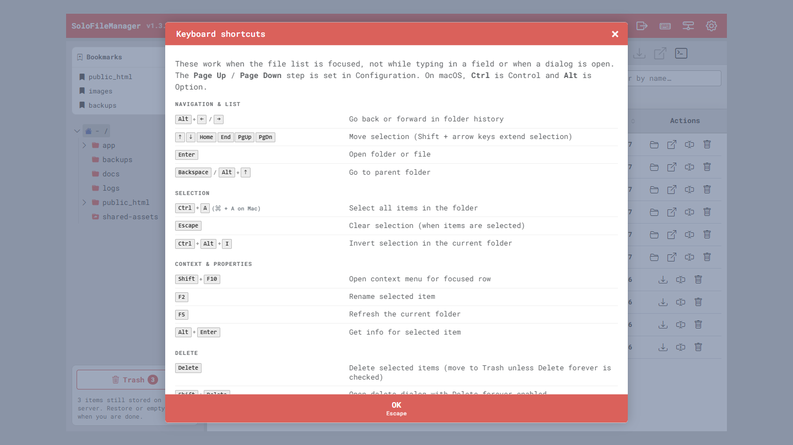
        </td>
        <td width="50%">
            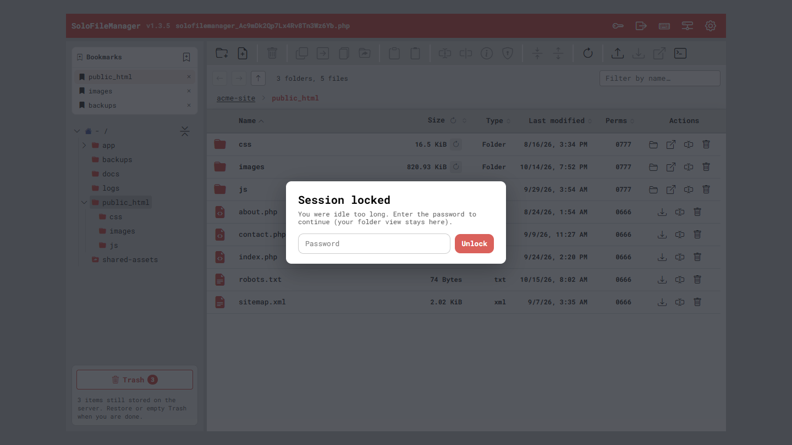
        </td>
    </tr>
</table>

## Quick start

1. Copy `solofilemanager.php` into the directory you want to manage (or into a web-accessible folder pointing at your target root).
2. Open it in the browser, e.g. `http://localhost/solofilemanager.php`
3. On first run, SoloFileManager asks you to **rename** the file. You can pick a pure random name (harder to find) or a `solofilemanager_`-prefixed name (easier to spot in the folder).
4. Log in with the default password **`admin`**. SoloFileManager then asks you to **set a new password** (new + confirm only — no need to retype `admin`). It tries to update `$PASSWORD_HASH` in the same PHP file; if the file is not writable, it shows a hash to paste manually. You can change the password later from the key icon in the header.

### Requirements

**PHP**

- PHP **7.4+** (`declare(strict_types=1)`)
- Extensions: **`json`**, **`session`** (required for the UI/API and login)
- **`mbstring`** recommended (better text encoding handling; SoloFileManager degrades without it)
- Compress / extract: **`zip`** (`ZipArchive`) and/or **`phar`** (`Phar` / `PharData`)
- Download as archive (folders / multiple items): streams through OS `zip` / `tar` via **`proc_open`** when available, otherwise a built-in PHP writer that needs **`zlib`** for ZIP and TAR.GZ (TAR works without it)
- **`exec()`** / **`proc_open()`** optional — when available and not in `disable_functions`, SoloFileManager can use OS tools for faster copy/move/delete/compress/extract/folder-size and streamed archive downloads (`$FM_FILE_OPS_MODE = 'auto'`). Without them, use `'php'` mode (or leave `'auto'` and rely on PHP fallbacks)

**Filesystem**

- The web server user must be able to **read** `$ROOT_DIR` and **write** where you create/upload/rename/delete files
- Uploads larger than PHP **`upload_max_filesize`** / **`post_max_size`** are sent in parts below those limits, so php.ini does not cap the file size. Each part must still fit the web server's request limit (e.g. nginx `client_max_body_size`); a part rejected with HTTP 413 is halved automatically. Unfinished parts are kept in a hidden `.fm-upload-tmp` folder under the root, so the root must be writable and have room for the file
- First-run self-rename needs write permission on the directory that contains `solofilemanager.php`
- Trash uses a hidden folder under root (default `.trash`); that path must be creatable/writable. It exists only while Trash holds items (created on the first delete, removed when Trash becomes empty). Deleted items are stored in `.trash/files/`, their original location in `.trash/info/`. On Apache an `.htaccess` blocks web access to it; on nginx / IIS deny that folder yourself (see [SECURITY.md](SECURITY.md))
- When you finish with SoloFileManager, **empty Trash** so removed files are not left on the server. The Trash button shows how many items are left, and Logout offers "Empty Trash and log out" when Trash is not empty

**Browser & network**

- A modern browser with **JavaScript** enabled
- Default UI loads **CDN** assets (Normalize CSS, Bootstrap Icons, Google Fonts). Offline or locked-down hosts need network access to those CDNs, or you must vendor the assets yourself

**Operating system notes**

- Full feature set (especially **chmod** / Unix permissions) works best on **Linux** and similar hosts
- On **Windows** (e.g. XAMPP), file management still works; permission bits are limited by the OS, and some shell/archive helpers may differ

## Features

- Folder tree (sidebar) with bookmarks and trash
- File/folder listing with sortable columns
- Remembers the last opened folder in the browser: reopen without a URL hash and you land there again (hash in the URL still wins)
- Optional session idle lock (off by default): lock after 15–120 minutes of idle time; unlock with the password without losing the current folder view. Long jobs keep the session alive
- Optional IP allowlist (off by default): only listed IPs / CIDR ranges (IPv4 and IPv6) can open the file manager; everyone else gets 403 before the login page
- Symlinks and Windows junctions shown as links (folder-link icon, arrow badge on file links); tooltip and Info show the target; links outside the root are dimmed and cannot be opened. Windows `.lnk` shortcuts to a folder inside the root open like a Folder link. Size, counts, PHP copy and archives do not follow links; copying a link recreates the link
- Create folder/file, rename, bulk rename, duplicate
- Copy / move with progress; drag and drop
- Delete to Trash or delete forever. Trash works like the Windows Recycle Bin: a flat list showing each item's original name, the folder it came from, deletion date and size, with Restore (back to where it was, renamed to "name (restored)" if that name is taken) and Delete forever; Empty Trash (with confirm); item count on the Trash button, a reminder on Logout, and Server info shows how many items / how much space Trash holds; the `.trash` folder is removed as soon as it is empty
- Filter the current folder listing by name (search field in the breadcrumb bar)
- Compress / extract archives
- Change permissions (chmod) for folders and files, including recursive 0755 / 0644 style fixes
- Upload (large files in parts, with retries on connection problems), get info, copy paths
- Download files, or folders and multiple items as ZIP / TAR / TAR.GZ — the browser download starts immediately while the archive is built; failures show the real reason
- Configuration popup (columns, permissions display, folder-size behavior, heavy file-ops mode)
- Change password from the UI (updates `$PASSWORD_HASH` in the same PHP file when writable)
- Keyboard shortcuts, server info
- Optional terminal-here (disabled by default — open the terminal icon for Terminal settings: Standard / Manual / Advanced, password to save; gear inside the terminal popup; or edit the `$FM_ENABLE_TERMINAL_*` flags; trusted hosts only)

## Configuration

Edit the config block at the top of `solofilemanager.php`:

| Setting | Purpose |
|---------|---------|
| `$ROOT_DIR` | Root path users may browse (default: script directory) |
| `$ENABLE_AUTH` / `$PASSWORD_HASH` | Session login (keep auth on). Prefer changing the password in the UI (key icon); manual hash paste is the fallback |
| `$FM_FILE_OPS_MODE` | `'auto'`, `'php'`, or `'os'` for heavy file operations. Prefer changing from **Configuration** (password to save); file edit is the fallback |
| `$FM_IDLE_TIMEOUT_MINUTES` | Idle session lock: `0` (off) or `15` / `30` / `60` / `120`. Prefer **Configuration** (password); file edit is the fallback |
| `$FM_ALLOWED_IPS` | IP allowlist, e.g. `['203.0.113.5', '192.168.1.0/24']`. Empty `[]` = everyone (default). Editable in **Configuration → Server** (password); if you lock yourself out, edit this line in the PHP file |
| `$FM_TRUSTED_PROXIES` | Reverse proxies (e.g. Cloudflare ranges) allowed to pass the real client IP in `X-Forwarded-For`. Empty = use the direct connection IP only (default). File edit only |
| `$FM_VERBOSE_PROGRESS_MIN_ITEMS` | When to show detailed progress for large jobs |
| `$FM_TRASH_BASENAME` | Hidden recycle folder under root (default `.trash`) |
| `$FM_ENABLE_TERMINAL_HERE` | Standard terminal-here (**false** by default). Prefer Terminal settings from the terminal icon (password); or set `true` in the file on trusted hosts only |
| `$FM_ENABLE_TERMINAL_MANUAL` / `$FM_ENABLE_TERMINAL_ADVANCED` | Manual / advanced modes (**false** by default). Same Terminal settings UI (gear in the terminal popup), or edit the file |

Manual password-hash recovery (only if the in-app update cannot write the file):

```php
echo password_hash('your-strong-password', PASSWORD_DEFAULT);
```

Paste the result into `$PASSWORD_HASH` near the top of the script.

## Security

SoloFileManager can create, rename, and delete files. Treat it as **high risk** if exposed on the public internet.

- Keep `$ENABLE_AUTH = true` and change the default `admin` password on first login
- Do not rely on the random filename alone
- Prefer HTTPS, IP allowlists, and/or HTTP Basic Auth at the web server. If you cannot change the web server config (shared hosting), use the built-in `$FM_ALLOWED_IPS` allowlist
- Built in: CSRF token on every state-changing request; session cookie is `HttpOnly` + `SameSite=Lax` and separate for each installation; changing the password logs out other sessions

See [SECURITY.md](SECURITY.md) for more.

## Changelog

See [CHANGELOG.md](CHANGELOG.md). Latest: **1.3.6** — security fix: each installation has its own login (copies on one domain no longer share it); a password change logs out other sessions. Update recommended.

## License

MIT — see [LICENSE](LICENSE). Others may use, modify, and redistribute SoloFileManager (including commercially), as long as they keep the copyright and license notice. The software is provided **as is**, without warranty.
